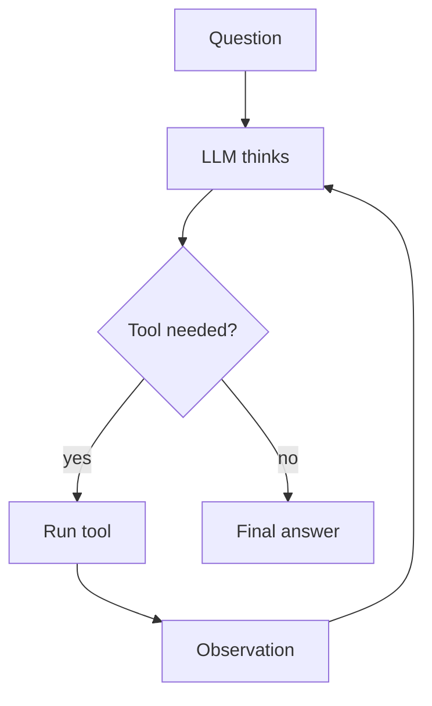

# Add a pattern

Each pattern is one folder: `agent_patterns/pNN_snake/` with `__init__.py` (empty), `graph.py`, `simple.py`, `test_graph.py`, `README.md`.
`tests/test_conventions.py` enforces the shape — run it often.

## Recipe

1. **Name it.** NN = number of existing `agent_patterns/pNN_*` folders + 1. Folder `pNN_snake_name`.
2. **Research.** Find the paper (arXiv) or official doc. Check every link: `curl -sIL -o /dev/null -w "%{http_code}" <url>` must print `200`. Never invent a source.
3. **Test first.** Create the folder and empty `__init__.py`, then `test_graph.py`: assert final state values and `llm.calls`, one test per parse fallback and per loop cap, plus `test_simple_matches_graph` (template below). Run every fallback/cap script through **both** `build_graph` and `simple.run` and assert they agree. Run `uv run pytest agent_patterns/pNN_x -q` and watch it fail.
4. **`graph.py`** from the skeleton below. Rules:
   - Prompts are module-level `UPPER_CASE` strings with `.format()` fields that state the exact reply format.
   - Parsers never raise on unexpected model text — they fall back (documented).
   - Parsers never return an empty string for a value a router checks (`text or "(empty reply)"`) — routing on `""` sends the graph down the wrong edge.
   - Every loop has a cap constant (`MAX_...`).
   - Never `eval`/`exec` model output.
   - Nodes are thin wrappers around module-level prompts, tools, parsers and helpers (so `simple.py` reuses them).
   - Parallel work uses `Send` + reducers, and the mock uses `by_keyword` (branch order is nondeterministic).
   - Every `add_conditional_edges` passes an explicit path list/map, so the diagram shows the edges.
   - `EXAMPLE_INPUT` holds every key the graph reads, including empty reducer lists.
5. **`simple.py`** from its skeleton: same helpers, plain control flow (`for`/`while`, `ThreadPoolExecutor` for parallel). Never import `langgraph`.
6. **Folder `README.md`** from the template below. Then `uv run python -m agent_patterns.core` fills the generated LangGraph diagram.
7. **Root `README.md`**: add the table row (link `agent_patterns/pNN_x/README.md` — the file, not the folder: local Markdown previews can't open folder links), a leaf in the "Which pattern should I use?" flowchart (`<br/>` for names over 20 chars), a "Quick picks" line with the exact name and README link, and the number in "Pattern families".
8. **Verify**: `uv run pytest -q` green; `uv run python -m agent_patterns.pNN_x.graph` prints the node trace; `uv run python -m agent_patterns.pNN_x.simple` prints the same answer.
9. **Commit**: `feat(pNN): add <Name> pattern`.

## `graph.py` skeleton

```python
"""NN · Name: one-line idea."""
from typing import TypedDict
from langchain_core.language_models import BaseChatModel
from langgraph.graph import StateGraph, START, END
from agent_patterns.core import MockLLM, get_llm, run_demo

class State(TypedDict):
    ...

def mock_llm() -> MockLLM:
    return MockLLM(responses=[...])

def build_graph(llm: BaseChatModel | None = None):
    llm = get_llm(mock_llm) if llm is None else llm
    g = StateGraph(State)
    ...
    return g.compile()

EXAMPLE_INPUT = {...}

if __name__ == "__main__":
    run_demo(build_graph(), EXAMPLE_INPUT)
```

## `simple.py` skeleton and parity test

```python
"""NN · Name in plain Python: same prompts, tools and mock as graph.py; only the control flow differs."""
from langchain_core.language_models import BaseChatModel
from agent_patterns.core import get_llm
from agent_patterns.pNN_x.graph import mock_llm, EXAMPLE_INPUT  # + prompts, tools, parsers, caps

def run(inputs: dict, llm: BaseChatModel | None = None) -> dict:
    llm = get_llm(mock_llm) if llm is None else llm
    ...

if __name__ == "__main__":
    print(run(EXAMPLE_INPUT))
```

```python
def test_simple_matches_graph():
    from agent_patterns.pNN_x.simple import run   # local import: graph tests run before simple.py exists
    g_llm, s_llm = mock_llm(), mock_llm()
    g = build_graph(g_llm).invoke(EXAMPLE_INPUT)
    s = run(EXAMPLE_INPUT, s_llm)
    # one assert per parity key; lists filled by parallel branches are compared sorted
    assert s_llm.calls == g_llm.calls
```

## Folder README template (≤ ~80 lines)

````markdown
# NN · Name

> One-sentence idea — Authors, Year ([arXiv XXXX.XXXXX](https://arxiv.org/abs/XXXX.XXXXX))

## In plain words
2–4 sentences, no jargon, one everyday analogy.

## How it works

1. 3–6 numbered steps.

## The LangGraph graph
<!-- mermaid:start -->
<!-- mermaid:end -->

| Node | Role |
|---|---|
| `node` | what it does |

Code: [graph.py](graph.py)

## Plain Python vs LangGraph
Same pattern in [simple.py](simple.py). 2–3 honest bullets: what the graph adds here, and when the plain loop is enough.

## Run it
```bash
uv run python -m agent_patterns.pNN_x.graph
uv run python -m agent_patterns.pNN_x.simple
USE_OPENROUTER=1 uv run --env-file .env python -m agent_patterns.pNN_x.graph
```
LLM calls in the mock example: **N**

## When to use
- 2 bullets

## When not to use
- 2 bullets

## vs. closest pattern
**vs X:** 1–2 lines.

## Sources
- curl-verified links only
````

Concept diagram rules (GitHub clips long labels): always quote node text (`A["Run tool"]`, `D{"Passed?"}`), at most 20 characters per line, `<br/>` for a second line, no arrows/emoji inside labels, edge labels 1–2 words.

## Next curriculum items

LATS, Supervisor multi-agent, Hierarchical teams, Handoffs/swarm, Multi-agent debate, Blackboard, Agentic RAG, CRAG, Self-RAG, Adaptive RAG, CodeAct, Program-of-Thought, Step-back, Human-in-the-loop, Agent memory, Guardrails.
