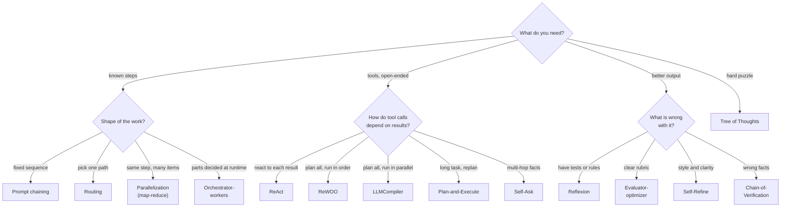

# AI Agent Design Patterns

AI agent design patterns, one folder each: a runnable LangGraph graph, the same pattern in plain Python, and a README with diagrams and a simple explanation.

## Quickstart

```bash
uv sync
uv run pytest
uv run python -m agent_patterns.p01_react.graph    # LangGraph version, prints each node as it runs
uv run python -m agent_patterns.p01_react.simple   # same pattern in plain Python
```

Everything runs offline on a scripted mock LLM — no API key needed.

## Real model (OpenRouter)

```bash
cp .env.example .env   # put your OPENROUTER_API_KEY in .env
USE_OPENROUTER=1 uv run --env-file .env python -m agent_patterns.p01_react.graph
```

Pick another model with `OPENROUTER_MODEL` (default `anthropic/claude-haiku-5.5`).

## Patterns

| #   | Pattern                                                                     | Family          | Idea                                                                     | LLM calls\* | Use when                                                   | Avoid when                                                         |
| --- | --------------------------------------------------------------------------- | --------------- | ------------------------------------------------------------------------ | ----------- | ---------------------------------------------------------- | ------------------------------------------------------------------ |
| 01  | [ReAct](agent_patterns/p01_react/README.md)                                 | Tool agent      | Think → act → observe loop, one LLM call per step                        | 3           | Steps unknown upfront; must react to tool results          | Fixed workflows; tight latency/cost budgets                        |
| 02  | [ReWOO](agent_patterns/p02_rewoo/README.md)                                 | Tool agent      | Plan every tool call once with #E variables, run them, then solve        | 2           | Predictable multi-tool lookups; fewer tokens than ReAct    | Later steps depend on surprises in earlier results                 |
| 03  | [Plan-and-Execute](agent_patterns/p03_plan_execute/README.md)               | Tool agent      | Planner writes steps, executor does one, replanner adjusts               | 5           | Long multi-step tasks; strong planner + cheap executor     | Short tasks (planning overhead); hard real-time                    |
| 04  | [Reflexion](agent_patterns/p04_reflexion/README.md)                         | Self-correction | Retry with verbal lessons learned from an external evaluator             | 3           | You have a ground-truth check (tests, rules, env reward)   | No reliable evaluator; one-shot tasks                              |
| 05  | [Self-Refine](agent_patterns/p05_self_refine/README.md)                     | Self-correction | Same model drafts, critiques itself, refines until no issues             | 4           | Polishing writing/code style; no external checker          | Factual errors the model can't see; cost-sensitive                 |
| 06  | [LLMCompiler](agent_patterns/p06_llm_compiler/README.md)                    | Tool agent      | Planner emits a task DAG; independent tool calls run in parallel         | 2           | Many independent tool calls; latency matters               | Strictly sequential tasks; side-effecting tools that need ordering |
| 07  | [Prompt chaining](agent_patterns/p07_prompt_chaining/README.md)             | Workflow        | Fixed sequence of LLM calls with code gates between them                 | 3           | Task splits into known steps; want checkable intermediates | Steps vary per input                                               |
| 08  | [Routing](agent_patterns/p08_routing/README.md)                             | Workflow        | Classify the input, send it to one specialized handler                   | 2           | Distinct input categories needing different prompts/models | Categories overlap; one prompt handles all well                    |
| 09  | [Parallelization (map-reduce)](agent_patterns/p09_map_reduce/README.md)     | Workflow        | Same LLM step on many inputs in parallel, then combine                   | 4           | Many independent chunks/docs; voting for confidence        | Items depend on each other; strict rate limits                     |
| 10  | [Orchestrator-workers](agent_patterns/p10_orchestrator_workers/README.md)   | Workflow        | LLM decides subtasks at runtime; workers run in parallel; results merged | 4           | Subtasks not known until you see the input                 | Fixed splits (use map-reduce); tiny tasks                          |
| 11  | [Evaluator-optimizer](agent_patterns/p11_evaluator_optimizer/README.md)     | Workflow        | Generator + separate judge loop until PASS                               | 4           | Clear quality rubric; iterating measurably helps           | No articulable criteria; first draft usually fine                  |
| 12  | [Self-Ask](agent_patterns/p12_self_ask/README.md)                           | Tool agent      | Model asks itself follow-up questions; search answers each               | 3           | Multi-hop factual questions                                | Single-hop questions; non-factual tasks                            |
| 13  | [Chain-of-Verification](agent_patterns/p13_chain_of_verification/README.md) | Self-correction | Draft, plan check questions, answer them independently, revise           | 6           | Cutting factual hallucinations in lists/long answers       | Creative tasks; latency-sensitive chat                             |
| 14  | [Tree of Thoughts](agent_patterns/p14_tree_of_thoughts/README.md)           | Search          | Branch into candidate thoughts, score, prune, search (BFS/beam)          | 10          | Puzzles/planning where partial steps can be scored         | Simple Q&A; no way to score intermediate steps                     |

\* LLM calls in the repo's mock example — a rough cost/latency signal.

## Pattern families

- **Tool agents** (01 ReAct, 02 ReWOO, 03 Plan-and-Execute, 06 LLMCompiler, 12 Self-Ask) — the LLM decides which tools to call and when.
- **Workflows** (07–11) — the flow is fixed in code and LLM calls fill in the steps; these follow Anthropic's "Building effective agents".
- **Self-correction** (04 Reflexion, 05 Self-Refine, 13 Chain-of-Verification) — check the output and improve it.
- **Search** (14 Tree of Thoughts) — explore several reasoning paths and prune the weak ones.

Start with the simplest workflow that works; reach for an agent only when the steps can't be known up front.

## Which pattern should I use?



**Quick picks**

- Fixed sequence of steps → [Prompt chaining](agent_patterns/p07_prompt_chaining/README.md)
- Different kinds of input need different handling → [Routing](agent_patterns/p08_routing/README.md)
- Same step over many independent items → [Parallelization (map-reduce)](agent_patterns/p09_map_reduce/README.md)
- Subtasks only known after reading the input → [Orchestrator-workers](agent_patterns/p10_orchestrator_workers/README.md)
- Open-ended tool use, each step depends on the last result → [ReAct](agent_patterns/p01_react/README.md)
- Tool calls predictable up front, run in order → [ReWOO](agent_patterns/p02_rewoo/README.md)
- Tool calls predictable up front, many independent → [LLMCompiler](agent_patterns/p06_llm_compiler/README.md)
- Long multi-step task that may need replanning → [Plan-and-Execute](agent_patterns/p03_plan_execute/README.md)
- Multi-hop factual question → [Self-Ask](agent_patterns/p12_self_ask/README.md)
- You have tests/rules to grade attempts → [Reflexion](agent_patterns/p04_reflexion/README.md)
- You can write a rubric for a separate judge → [Evaluator-optimizer](agent_patterns/p11_evaluator_optimizer/README.md)
- Polish style and clarity, no checker → [Self-Refine](agent_patterns/p05_self_refine/README.md)
- Factual answers that must not hallucinate → [Chain-of-Verification](agent_patterns/p13_chain_of_verification/README.md)
- Hard puzzle/planning where partial steps can be scored → [Tree of Thoughts](agent_patterns/p14_tree_of_thoughts/README.md)

## Plain Python or LangGraph?

Every folder ships both: `simple.py` (plain Python) and `graph.py` (LangGraph) use the same prompts, tools and mock, and a parity test checks they give the same result. The graph pays off when you need:

- **Parallel branches** — `Send` + reducers instead of thread pools and manual merging (LLMCompiler, map-reduce, Orchestrator-workers, Chain-of-Verification).
- **Long or expensive runs** — a checkpointer saves each step so a crash resumes instead of restarting.
- **Human-in-the-loop** — `interrupt` pauses before a tool call or between rounds for approval.
- **Observability** — per-node trace (`stream`), a diagram generated from the code, LangGraph Studio / LangSmith.

Short loops (Self-Refine, Self-Ask, Evaluator-optimizer) read better as plain Python.

## Adding a pattern

In Claude Code run `/add-pattern <name>` — the recipe lives in [.claude/skills/add-pattern/SKILL.md](.claude/skills/add-pattern/SKILL.md).
`tests/test_conventions.py` fails until the new folder, its diagrams and its table row are all in place.
