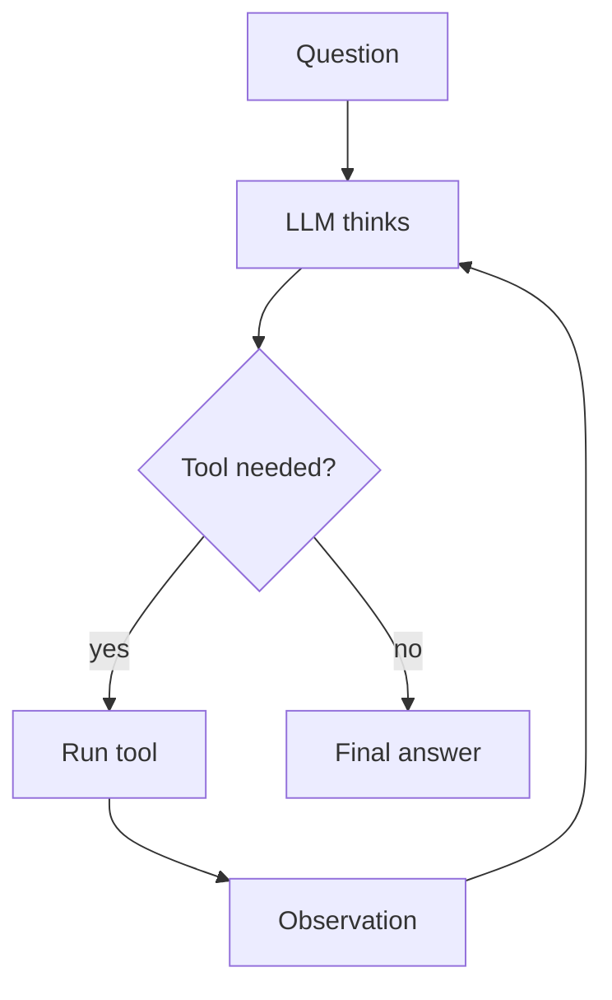
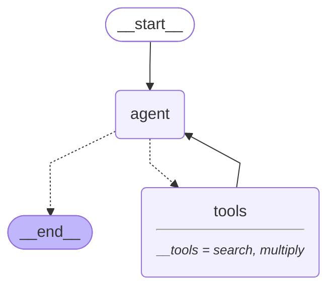

# 01 · ReAct

> Interleave reasoning and acting: the model thinks, calls a tool, reads the result, and decides again — Yao et al., 2022 ([arXiv 2210.03629](https://arxiv.org/abs/2210.03629))

## In plain words

The model doesn't try to answer in one go. It thinks about what it needs, uses a tool (search, calculator, API), looks at what came back, and then decides the next move. It repeats until it has enough to answer.
Like a detective: look at a clue, decide where to look next, repeat until the case is solved.

## How it works



1. The LLM gets the question plus everything seen so far.
2. It either asks for a tool call (an *action*) or writes the final answer.
3. The tool runs and its result (the *observation*) is added to the conversation.
4. Back to step 1 — the LLM is called again after **every** observation.

## The LangGraph graph

<!-- mermaid:start -->

<!-- mermaid:end -->

| Node | Role |
|---|---|
| `agent` | LLM with tools bound: returns a tool call or the final answer |
| `tools` | `ToolNode` runs the requested tools and appends their results |
| `tools_condition` | edge: go to `tools` if the last message has tool calls, else end |

Code: [graph.py](graph.py)

## Plain Python vs LangGraph

Same pattern in [simple.py](simple.py) — a `for` loop of about 15 lines.

- For one agent with a couple of tools, the plain loop is perfectly fine.
- The graph adds a per-step trace (`stream`), `ToolNode` error handling (a bad tool call becomes a message, not a crash) and `recursion_limit` as the loop guard.
- Adding human approval before a tool runs later is one `interrupt` in the graph; in the plain loop you build it yourself.

## Run it

```bash
uv run python -m agent_patterns.p01_react.graph
uv run python -m agent_patterns.p01_react.simple
USE_OPENROUTER=1 uv run --env-file .env python -m agent_patterns.p01_react.graph
```

LLM calls in the mock example: **3** (one per step, including the final answer). Guard the loop with `graph.invoke(x, {"recursion_limit": 10})`.

## When to use

- You don't know upfront how many steps or which tools the task needs.
- Each step depends on what the previous tool returned.

## When not to use

- The steps are fixed and known — a prompt chain is cheaper and more predictable.
- Tight latency or cost budgets with many tool calls: every observation costs another LLM call over the whole history.

## vs. closest pattern

**vs ReWOO:** ReAct re-plans after every tool result, so it adapts to surprises but pays an LLM call per step. ReWOO plans all tool calls once, up front.

## Sources

- [ReAct: Synergizing Reasoning and Acting in Language Models (arXiv 2210.03629)](https://arxiv.org/abs/2210.03629)
