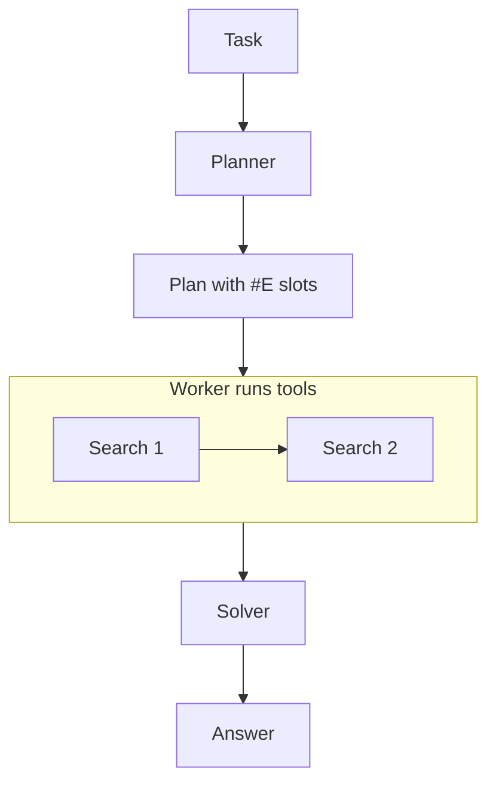
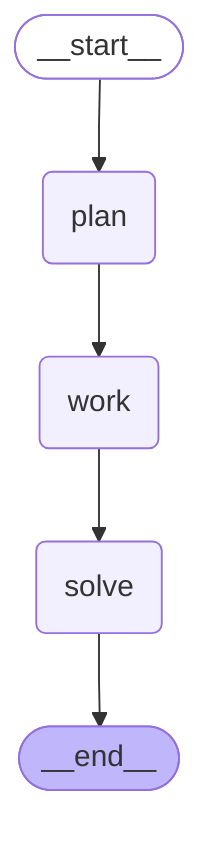

# 02 · ReWOO

> Reasoning WithOut Observation: plan all tool calls at once with placeholders, run them, then solve — Xu et al., 2023

## In plain words

Instead of asking the model again after every tool result, ReWOO asks it once for the whole plan — "first look up X, then look up Y using X" — with blanks for results it doesn't have yet. A simple worker fills the blanks by running the tools, and the model is asked one last time to write the answer.
Like a shopping list: you plan the whole trip at home, then just walk the aisles without phoning home after every item.

## How it works



1. **Planner** (1 LLM call) writes every step as `#E1 = Search[...]`, `#E2 = Search[... #E1 ...]`.
2. **Worker** (no LLM reasoning) runs the tools in order, replacing `#E1` with the real result before step 2.
3. **Solver** (1 LLM call) reads the plan plus all evidence and writes the answer.

No LLM call happens between tools — that is the whole saving.

## The LangGraph graph

<!-- mermaid:start -->

<!-- mermaid:end -->

| Node | Role |
|---|---|
| `plan` | one LLM call; parses `#En = Tool[input]` lines into steps |
| `work` | `run_steps`: runs each tool in order, substituting earlier results |
| `solve` | one LLM call with plan + evidence |

Code: [graph.py](graph.py)

## Plain Python vs LangGraph

Same pattern in [simple.py](simple.py) — three function calls in a row.

- The flow is a straight line, so plain Python is just as clear here.
- The graph only adds a per-node trace and, with a checkpointer, persistence between steps.

## Run it

```bash
uv run python -m agent_patterns.p02_rewoo.graph
uv run python -m agent_patterns.p02_rewoo.simple
USE_OPENROUTER=1 uv run --env-file .env python -m agent_patterns.p02_rewoo.graph
```

LLM calls in the mock example: **2** — and it stays 2 no matter how many tools the plan uses.

## When to use

- Multi-tool lookups whose steps are predictable from the question alone.
- You want fewer tokens and LLM calls than ReAct (the paper reports large token savings).

## When not to use

- A later step depends on a surprise in an earlier result (the plan can't change mid-way).
- Tools fail often — there is no chance to react until the solver.

## vs. closest pattern

**vs ReAct:** ReWOO never observes between steps, so it can't adapt if step 1 returns something unexpected; ReAct can, at the cost of an LLM call per step.
