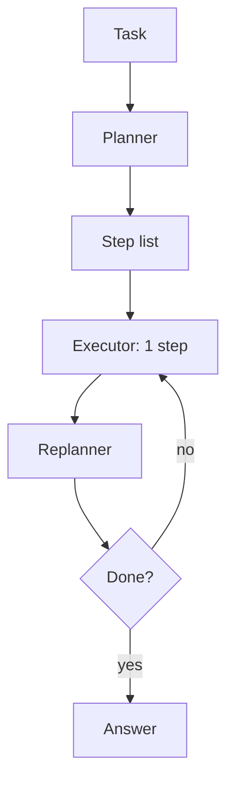
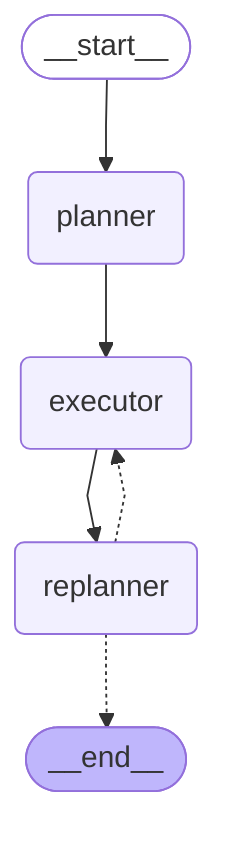

# 03 · Plan-and-Execute

> A planner writes the steps, an executor does one step at a time, and a replanner updates the rest — builds on Plan-and-Solve, Wang et al., 2023

## In plain words

First the model writes a to-do list. Then it does the first item, looks at the result, and rewrites the rest of the list if needed. It stops when the replanner says the goal is reached.
Like cooking from a recipe you adjust as you go: taste after each step and change the remaining steps if something's off.

## How it works



1. **Planner** writes a numbered plan.
2. **Executor** does only the first remaining step.
3. **Replanner** sees what's done and either answers (`FINAL: ...`) or writes the remaining steps.
4. Repeat 2–3, with a hard cap (`MAX_STEPS = 6`) in case the replanner never finishes.

## The LangGraph graph

<!-- mermaid:start -->

<!-- mermaid:end -->

| Node | Role |
|---|---|
| `planner` | LLM writes the numbered plan (falls back to the whole task as one step) |
| `executor` | LLM does `plan[0]`, appends `(step, result)` to `past_steps` |
| `replanner` | LLM: `FINAL:` ends the run, otherwise a new remaining plan; stops at `MAX_STEPS` |

Code: [graph.py](graph.py)

## Plain Python vs LangGraph

Same pattern in [simple.py](simple.py) — a `while` loop.

- The graph makes the plan → do → replan loop visible as a diagram and a per-node trace.
- With a checkpointer, a long multi-step task can resume after a crash instead of starting over — the main reason to use a graph here.
- For short tasks the plain loop is easier to read.

## Run it

```bash
uv run python -m agent_patterns.p03_plan_execute.graph
uv run python -m agent_patterns.p03_plan_execute.simple
USE_OPENROUTER=1 uv run --env-file .env python -m agent_patterns.p03_plan_execute.graph
```

LLM calls in the mock example: **5** (plan, then do + replan twice).

## When to use

- Long multi-step tasks where a big-picture plan helps keep the agent on track.
- You want a strong (expensive) model to plan and a cheaper model or a ReAct sub-agent to execute each step.

## When not to use

- Short tasks — planning and replanning cost more than they save.
- Hard real-time needs: every step adds an executor and a replanner call.

## vs. closest pattern

**vs ReWOO:** both plan up front, but Plan-and-Execute revisits the plan after every step, so it can recover from surprises; ReWOO never changes its plan.
