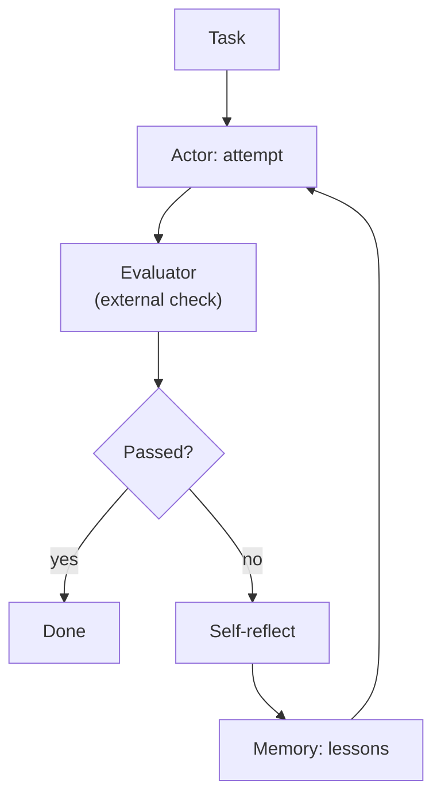
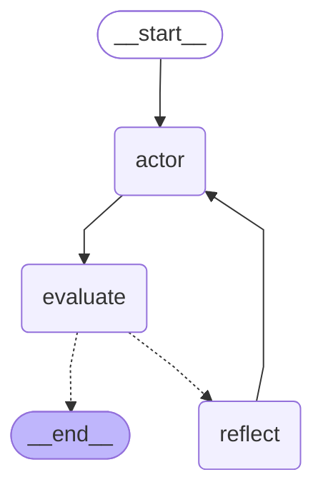

# 04 · Reflexion

> Learn from failure in words: an external check grades each attempt, the model writes a lesson, and the next attempt reads every lesson so far — Shinn et al., 2023 ([arXiv 2303.11366](https://arxiv.org/abs/2303.11366))

## In plain words

The model tries, and something outside the model — tests, rules, a game score — says pass or fail. On a fail, the model writes a short note to itself ("too long, drop the exclamation mark") and tries again with all its notes in front of it.
Like a student keeping a mistakes notebook: after each graded exam, write down what went wrong and read the notebook before the next one.

## How it works



1. **Actor** (LLM) makes an attempt, with every earlier lesson in its prompt.
2. **Evaluator** (plain code here: word count, must say "planet", no "!") returns the failed checks.
3. If it failed, **Reflect** (LLM) turns the failures into a one-line lesson, stored in memory.
4. Retry, up to `MAX_TRIALS = 3`.

## The LangGraph graph

<!-- mermaid:start -->

<!-- mermaid:end -->

| Node | Role |
|---|---|
| `actor` | LLM writes an attempt using the task + all reflections |
| `evaluate` | `check_slogan`: external rules, no LLM; sets `passed` |
| `reflect` | LLM writes a lesson from the failures; appended to `reflections` |

Code: [graph.py](graph.py)

## Plain Python vs LangGraph

Same pattern in [simple.py](simple.py) — a `for trial in range(...)` loop.

- The plain loop is shorter and easy to follow.
- The graph pays off when trials are slow or costly (e.g. running a test suite): a checkpointer saves each trial, and an `interrupt` lets a human approve or edit the lesson before the next attempt.

## Run it

```bash
uv run python -m agent_patterns.p04_reflexion.graph
uv run python -m agent_patterns.p04_reflexion.simple
USE_OPENROUTER=1 uv run --env-file .env python -m agent_patterns.p04_reflexion.graph
```

LLM calls in the mock example: **3** (attempt, reflect, attempt).

## When to use

- You have a ground-truth check: unit tests, a validator, rules, an environment reward.
- Repeated attempts on the same task are acceptable, and lessons carry over between them.

## When not to use

- No reliable evaluator — the model grading itself is Self-Refine, and it can't see its own blind spots.
- One-shot tasks where there is no second attempt.

## vs. closest pattern

**vs Self-Refine:** Reflexion needs an *external* signal and keeps lessons across trials as memory; Self-Refine is the model critiquing itself within one task. The paper's evaluators include unit tests, environment rewards and heuristics.

## Sources

- [Reflexion: Language Agents with Verbal Reinforcement Learning (arXiv 2303.11366)](https://arxiv.org/abs/2303.11366)
