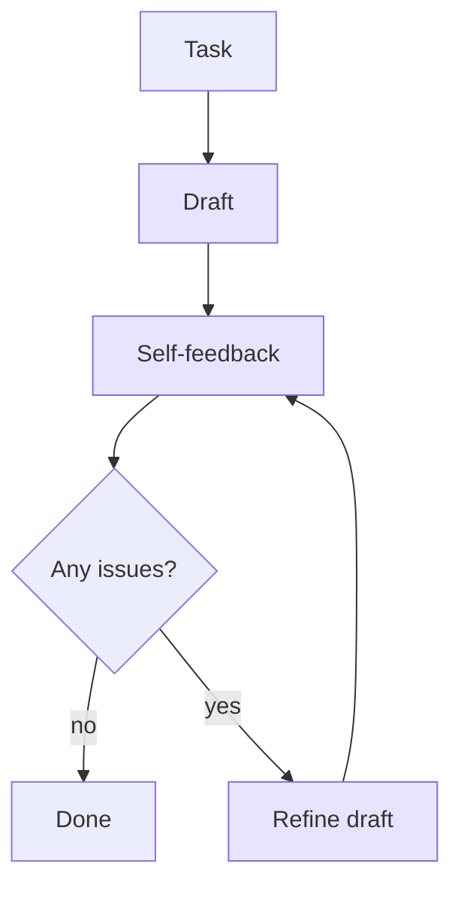
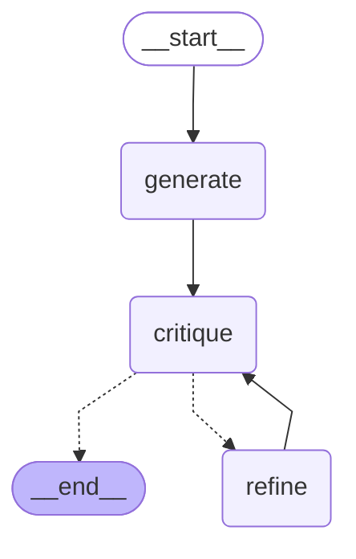

# 05 · Self-Refine

> One model writes, critiques its own output, and rewrites it — no extra training, no external judge — Madaan et al., 2023 ([arXiv 2303.17651](https://arxiv.org/abs/2303.17651))

## In plain words

The model writes a first draft, then reads it back as a critic ("too vague — say what was fixed"), then rewrites it using that feedback. It loops until its own critique says "no issues" or a round limit is hit.
Like proofreading your own email before sending: write, reread, fix, reread.

## How it works



The three shaded boxes are **the same LLM** playing three roles.

1. **Generate** a first draft.
2. **Critique** it — the prompt asks for concrete problems, or exactly `NO_ISSUES`.
3. **Refine** using the feedback; keep the old draft in `history`.
4. Repeat 2–3 until `NO_ISSUES` or `MAX_ITERATIONS = 3`.

## The LangGraph graph

<!-- mermaid:start -->

<!-- mermaid:end -->

| Node | Role |
|---|---|
| `generate` | LLM writes the first draft |
| `critique` | same LLM reviews its draft; counts the round |
| `refine` | same LLM rewrites from the feedback; old draft goes to `history` |

Code: [graph.py](graph.py)

## Plain Python vs LangGraph

Same pattern in [simple.py](simple.py) — a `while` loop.

- The plain loop wins on clarity here; there's nothing parallel or long-running.
- The graph adds a trace of each critique round, which is handy when you're tuning the critique prompt.

## Run it

```bash
uv run python -m agent_patterns.p05_self_refine.graph
uv run python -m agent_patterns.p05_self_refine.simple
USE_OPENROUTER=1 uv run --env-file .env python -m agent_patterns.p05_self_refine.graph
```

LLM calls in the mock example: **4** (draft, critique, refine, critique).

## When to use

- Polishing style and clarity: writing, commit messages, code readability.
- There's no external checker, but the model can recognize a better version when it sees one.

## When not to use

- Factual errors the model doesn't know are errors — it will happily approve them.
- Cost- or latency-sensitive paths: every round is two more LLM calls.

## vs. closest pattern

**vs Evaluator-optimizer:** that pattern uses a separate judge role (possibly a different model) with explicit PASS/FAIL criteria; Self-Refine is one model grading itself free-form.

## Sources

- [Self-Refine: Iterative Refinement with Self-Feedback (arXiv 2303.17651)](https://arxiv.org/abs/2303.17651)
