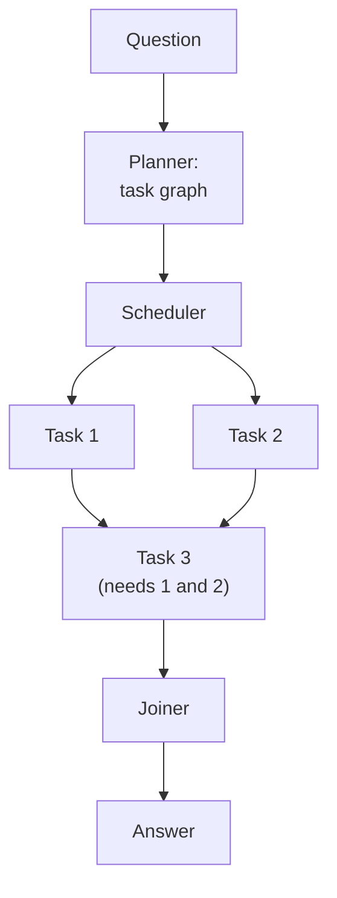
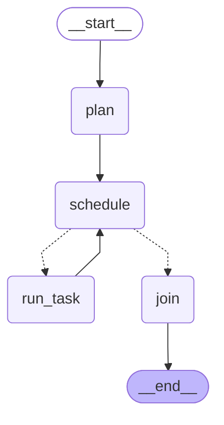

# 06 · LLMCompiler

> Plan tool calls as a dependency graph and run every call whose inputs are ready in parallel — Kim et al., 2023

## In plain words

The model writes all the tool calls it needs and says which ones depend on which. Calls that don't depend on each other run at the same time; a call that needs earlier results waits for them. One last LLM call writes the answer.
Like a kitchen with several cooks: chop vegetables and boil water at the same time, and start the sauce only when both are done.

## How it works



1. **Planner** (1 LLM call) writes numbered calls like `3. subtract($1, $2)`; `$1` means "result of task 1".
2. **Scheduler** finds every task whose dependencies are done — that's one *wave*.
3. The wave runs **in parallel**; results are merged by task id.
4. Back to the scheduler until nothing is ready, then the **Joiner** (1 LLM call) answers.

## The LangGraph graph

<!-- mermaid:start -->

<!-- mermaid:end -->

| Node | Role |
|---|---|
| `plan` | LLM writes the task list; `parse_tasks` extracts tools, inputs and `$` dependencies |
| `schedule` | records the next wave of ready tasks (a barrier: runs after the whole wave finishes) |
| `run_task` | one `Send` per ready task — they run in parallel; results merge via a dict reducer |
| `join` | LLM answers from all results |

Code: [graph.py](graph.py)

## Plain Python vs LangGraph

Same pattern in [simple.py](simple.py) — a `while` loop with a `ThreadPoolExecutor`.

- This is where the graph earns its keep: `Send` fans out one branch per task and the `operator.or_` reducer merges results, instead of hand-written thread pools, dict merging and wave bookkeeping.
- The trace shows each parallel task as its own step, which is hard to get from a thread pool.

## Run it

```bash
uv run python -m agent_patterns.p06_llm_compiler.graph
uv run python -m agent_patterns.p06_llm_compiler.simple
USE_OPENROUTER=1 uv run --env-file .env python -m agent_patterns.p06_llm_compiler.graph
```

LLM calls in the mock example: **2** (planner + joiner). The trace shows waves `[[1, 2], [3]]`.

## When to use

- Many independent tool calls (lookups, API calls) where latency matters.
- The plan's shape is predictable enough to write up front.

## When not to use

- Strictly sequential tasks — there's nothing to parallelize, so it's ReWOO with extra machinery.
- Side-effecting tools whose order matters beyond the declared dependencies.

## vs. closest pattern

**vs ReWOO:** both plan up front with placeholders, but LLMCompiler plans a dependency graph and runs independent calls in parallel; ReWOO runs them one by one. The paper also lets the joiner trigger a replan, which this repo skips.
