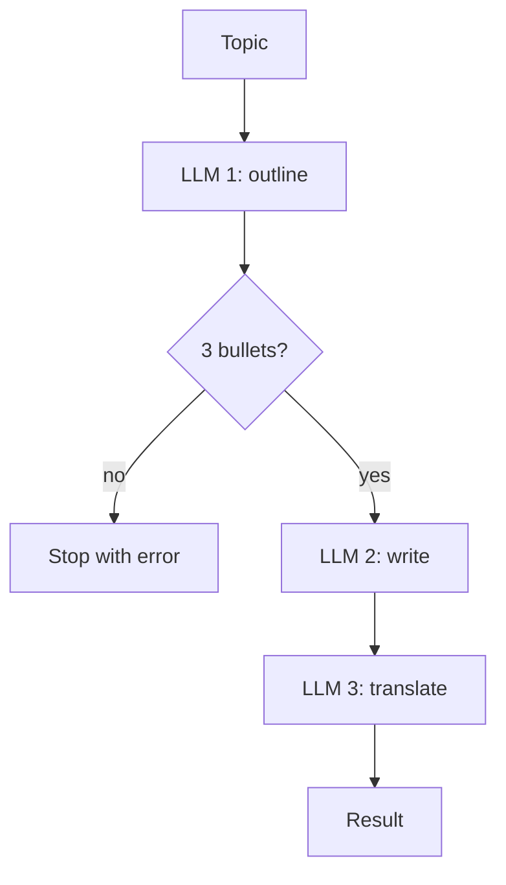
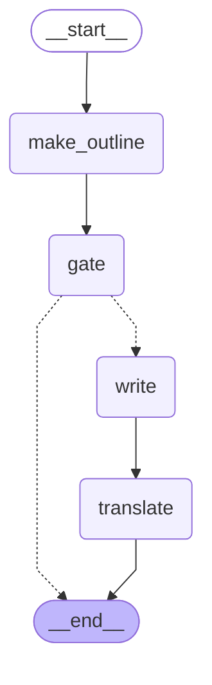

# 07 · Prompt chaining

> Split a task into a fixed sequence of LLM calls, each working on the previous one's output, with code checks ("gates") in between

## In plain words

Instead of one giant prompt, you break the job into small steps you already know: outline → write → translate. Each step is an easy, focused LLM call, and between steps plain code can check the result and stop early if something's wrong.
Like an assembly line: each station does one job, and a quality check between stations pulls bad parts off the line.

## How it works



1. **Outline**: the LLM writes exactly 3 selling points.
2. **Gate** (plain code, free): fewer than 3 bullets → stop with an error instead of wasting two more calls.
3. **Write**: the LLM turns the outline into a paragraph.
4. **Translate**: the LLM translates it to Hebrew.

## The LangGraph graph

<!-- mermaid:start -->

<!-- mermaid:end -->

| Node | Role |
|---|---|
| `make_outline` | LLM: 3 bullets |
| `gate` | `check_outline`: plain code; sets `error` if the outline is bad |
| `write` | LLM: paragraph from the outline |
| `translate` | LLM: Hebrew translation |

Code: [graph.py](graph.py)

## Plain Python vs LangGraph

Same pattern in [simple.py](simple.py) — three calls and one `if`.

- For a fixed chain, plain Python is the clearer choice.
- The graph adds a per-step trace and, with a checkpointer, retry/resume of just the failed step instead of the whole chain.

## Run it

```bash
uv run python -m agent_patterns.p07_prompt_chaining.graph
uv run python -m agent_patterns.p07_prompt_chaining.simple
USE_OPENROUTER=1 uv run --env-file .env python -m agent_patterns.p07_prompt_chaining.graph
```

LLM calls in the mock example: **3** (1 if the gate stops the chain).

## When to use

- The task splits cleanly into known steps, and each step is easier than the whole.
- You want checkable intermediate results (a gate between steps catches problems early).

## When not to use

- The steps change from input to input — let an LLM plan them (Plan-and-Execute, Orchestrator-workers).
- One call already does the job well — chaining adds latency per step.

## vs. closest pattern

**vs Plan-and-Execute:** here the steps are fixed in code; in Plan-and-Execute the LLM decides the steps at runtime.
