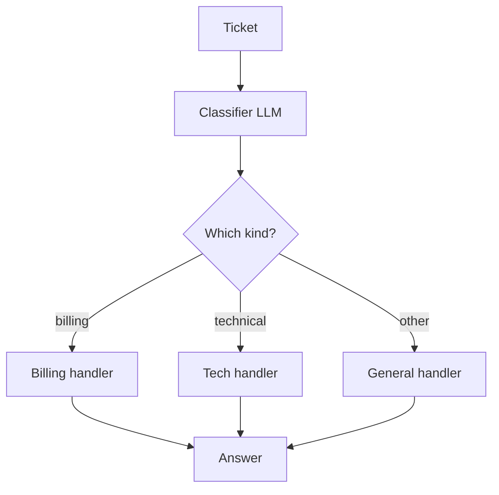
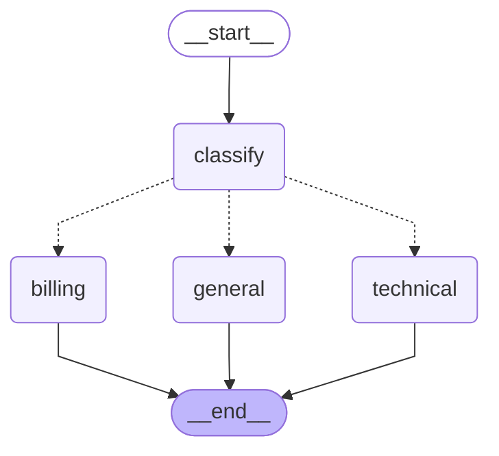

# 08 · Routing

> Classify the input first, then hand it to one specialized handler with its own prompt (or model) — Anthropic, "Building effective agents" (Schluntz & Zhang, 2024)

## In plain words

One quick LLM call reads the request and decides what kind it is — billing, technical, or general. Then only the matching specialist handles it, with a prompt written just for that kind of request.
Like a hospital reception desk: the receptionist doesn't treat you, they send you to the right department.

## How it works



1. **Classify**: the LLM answers with one word.
2. **Normalize** in code: `"Technical."` → `technical`; anything unknown → `general` (never crash on a weird label).
3. **Handle**: exactly one handler runs, with its own system prompt.

## The LangGraph graph

<!-- mermaid:start -->

<!-- mermaid:end -->

| Node | Role |
|---|---|
| `classify` | LLM label → `parse_route` → `route` |
| `billing` / `technical` / `general` | one specialized LLM call each; only one runs |

Code: [graph.py](graph.py)

## Plain Python vs LangGraph

Same pattern in [simple.py](simple.py) — a dict lookup `HANDLER_PROMPTS[route]`.

- About the same size either way.
- The graph's diagram shows every route at a glance, and each handler can grow into its own subgraph (e.g. the technical route becomes a ReAct agent) without touching the others.

## Run it

```bash
uv run python -m agent_patterns.p08_routing.graph
uv run python -m agent_patterns.p08_routing.simple
USE_OPENROUTER=1 uv run --env-file .env python -m agent_patterns.p08_routing.graph
```

LLM calls in the mock example: **2** (classify + one handler).

## When to use

- Inputs fall into distinct categories that need different prompts, tools or models.
- You want to send easy requests to a cheap model and hard ones to a strong model.

## When not to use

- Categories overlap a lot — misroutes hurt more than one general prompt would.
- One prompt already handles everything well; routing just adds a call.

## vs. closest pattern

**vs Orchestrator-workers:** a router picks **one** path; an orchestrator splits the task and fans out to **many** workers.

## Sources

- [Anthropic: Building effective agents](https://www.anthropic.com/engineering/building-effective-agents)
