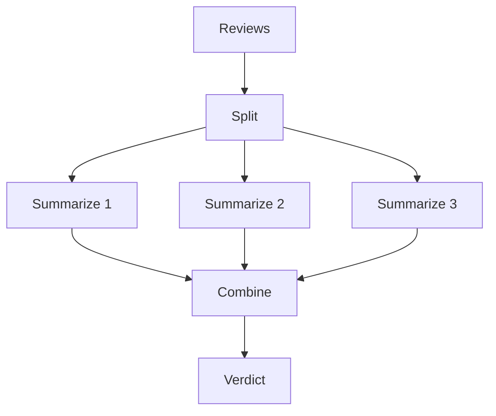
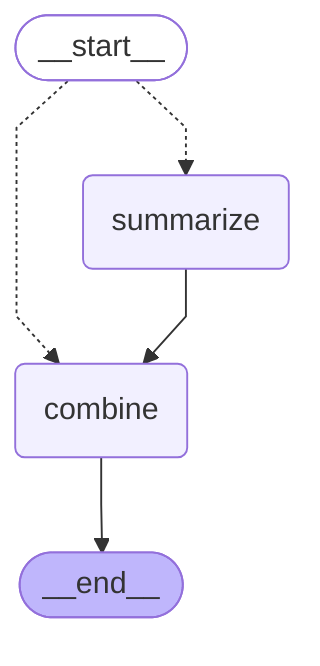

# 09 · Parallelization (map-reduce)

> Run the same LLM step on many independent inputs at the same time, then combine the results

## In plain words

When you have many similar pieces — reviews, documents, chunks — you don't process them one after another. You send each piece to its own LLM call at the same time (map), then one final call merges all the small results into one (reduce).
Like grading exams with a team: each grader takes a stack in parallel, then the head teacher combines the grades.

## How it works



1. **Split** in code: one branch per review — the number of branches is just `len(reviews)`.
2. **Map**: every branch summarizes its review, all in parallel.
3. **Reduce**: one LLM call combines the summaries (sorted, so the prompt doesn't depend on which branch finished first).
4. No reviews → skip the LLM entirely.

A variant, **voting**: run the *same* prompt N times in parallel and take the majority answer, for more confidence.

## The LangGraph graph

<!-- mermaid:start -->

<!-- mermaid:end -->

| Node | Role |
|---|---|
| `fan_out` (edge) | one `Send("summarize", ...)` per review, or straight to `combine` if empty |
| `summarize` | LLM: 5-word summary of one review; results append via the `operator.add` reducer |
| `combine` | LLM: one verdict from all summaries |

Code: [graph.py](graph.py)

## Plain Python vs LangGraph

Same pattern in [simple.py](simple.py) — `ThreadPoolExecutor().map(...)` then one call.

- About the same size. `Send` plus a reducer merges the branch results for you, and each branch shows up in the trace and can stream on its own.
- With a checkpointer, a crash mid-way doesn't redo the branches that already finished.

## Run it

```bash
uv run python -m agent_patterns.p09_map_reduce.graph
uv run python -m agent_patterns.p09_map_reduce.simple
USE_OPENROUTER=1 uv run --env-file .env python -m agent_patterns.p09_map_reduce.graph
```

LLM calls in the mock example: **4** (3 parallel summaries + 1 combine). The mock answers by keyword because parallel branches call it in any order.

## When to use

- Many independent chunks or documents that each need the same treatment.
- You want several opinions on one question (voting) for more confidence.

## When not to use

- The items depend on each other — a later one needs an earlier one's result.
- Strict API rate limits: N parallel calls arrive at once.

## vs. closest pattern

**vs Orchestrator-workers:** here the split is fixed by code (one branch per input); there an LLM decides at runtime what the subtasks are.
