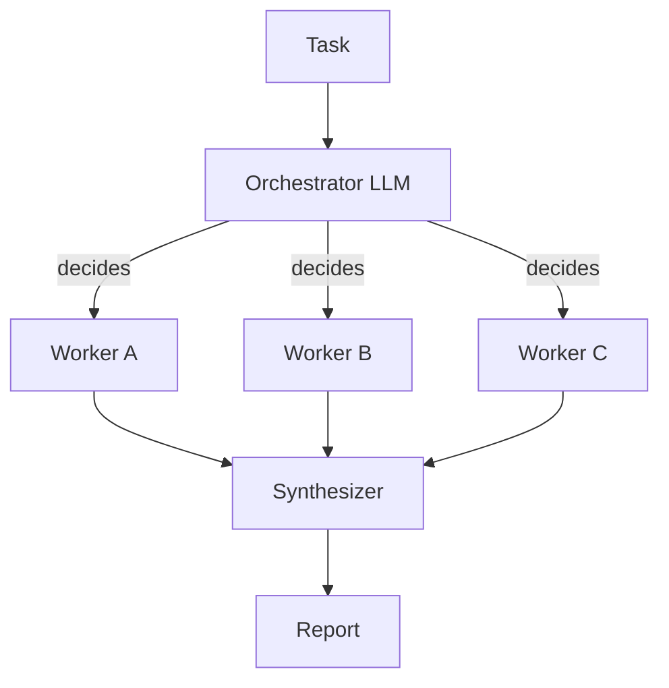
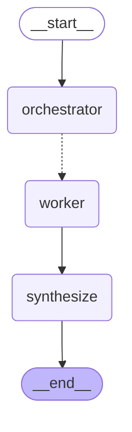

# 10 · Orchestrator-workers

> A central LLM breaks the task into subtasks it picks at runtime, hands each to a worker, and the results are merged — Anthropic, "Building effective agents" (Schluntz & Zhang, 2024)

## In plain words

You don't know in advance how the job splits up — it depends on the input. So a "manager" LLM looks at the task and decides the parts (here: README sections). Each part goes to its own worker at the same time, and the pieces are put together in the manager's order.
Like an editor planning a magazine issue: decide the articles for this issue, give one to each writer, then lay them out in order.

## How it works



The number of workers is chosen at runtime by the orchestrator, not by code.

1. **Orchestrator** (LLM) lists the section titles — capped at `MAX_SECTIONS = 5`.
2. **Workers** (one LLM call each, in parallel) write one section.
3. **Synthesizer** (plain code) joins the sections **in the plan's order**, whatever order the workers finished in.

## The LangGraph graph

<!-- mermaid:start -->

<!-- mermaid:end -->

| Node | Role |
|---|---|
| `orchestrator` | LLM picks the sections (`parse_sections`, capped) |
| `assign` (edge) | one `Send("worker", ...)` per section |
| `worker` | LLM writes one section; `(title, text)` appended via reducer |
| `synthesize` | `assemble`: code, no LLM |

Code: [graph.py](graph.py)

## Plain Python vs LangGraph

Same pattern in [simple.py](simple.py) — one call, a `ThreadPoolExecutor`, then `assemble`.

- Like map-reduce, but the fan-out width comes from the LLM at runtime — `Send` handles a variable number of branches natively.
- The trace shows each worker as its own step; a checkpointer keeps finished sections if one worker fails.

## Run it

```bash
uv run python -m agent_patterns.p10_orchestrator_workers.graph
uv run python -m agent_patterns.p10_orchestrator_workers.simple
USE_OPENROUTER=1 uv run --env-file .env python -m agent_patterns.p10_orchestrator_workers.graph
```

LLM calls in the mock example: **4** (1 orchestrator + 3 workers).

## When to use

- The subtasks aren't known until you see the input (which files to change, which sections to write).
- Subtasks are independent enough to run in parallel.

## When not to use

- The split is fixed (one per document) — plain map-reduce is simpler and cheaper.
- Tiny tasks where one call is enough.

## vs. closest pattern

**vs Map-reduce:** there the code splits the work (one branch per input); here an LLM decides the subtasks at runtime.

## Sources

- [Anthropic: Building effective agents](https://www.anthropic.com/engineering/building-effective-agents)
