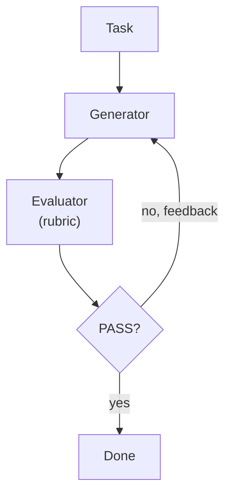
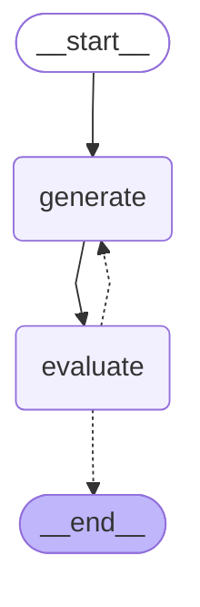

# 11 · Evaluator-optimizer

> One LLM generates, a separate LLM judge grades it against clear criteria and explains what to fix; loop until it passes — Anthropic, "Building effective agents" (Schluntz & Zhang, 2024)

## In plain words

Two roles: a writer and a strict reviewer with a checklist. The writer drafts; the reviewer says PASS or "FAIL: here's what to fix". The writer tries again with that feedback, until the reviewer passes it or the round limit is hit.
Like a translator and an editor: the editor sends it back with notes until it reads right.

## How it works



1. **Generator** writes a draft (with the judge's last feedback, if any).
2. **Evaluator** grades it against a rubric: correct meaning, warm tone, natural Hebrew → `PASS` or `FAIL: ...`.
3. Anything that isn't a clear `PASS` counts as a fail — a confused judge can't accidentally approve.
4. Loop until PASS or `MAX_ATTEMPTS = 3`.

## The LangGraph graph

<!-- mermaid:start -->

<!-- mermaid:end -->

| Node | Role |
|---|---|
| `generate` | LLM writes a draft using the task + last feedback |
| `evaluate` | judge LLM; `parse_grade` → `grade` + `feedback` |

Code: [graph.py](graph.py)

## Plain Python vs LangGraph

Same pattern in [simple.py](simple.py) — a `while` loop.

- The plain loop is shorter.
- In the graph, an `interrupt` before `generate` lets a human read the judge's verdict and approve, override, or add their own feedback — a common production need.

## Run it

```bash
uv run python -m agent_patterns.p11_evaluator_optimizer.graph
uv run python -m agent_patterns.p11_evaluator_optimizer.simple
USE_OPENROUTER=1 uv run --env-file .env python -m agent_patterns.p11_evaluator_optimizer.graph
```

LLM calls in the mock example: **4** (draft, judge, draft, judge).

## When to use

- You can write clear quality criteria, and iterating measurably improves the result (translation, tone, docs).
- You want the judge to be a different, stronger or cheaper model than the writer (here they share one; see the `ponytail:` note in `graph.py`).

## When not to use

- You can't articulate criteria — the judge will be as vague as the generator.
- The first draft is usually fine; the extra judge call is pure cost.

## vs. closest pattern

**vs Self-Refine:** here the judge is a separate role with a rubric and a hard PASS/FAIL; in Self-Refine one model critiques itself free-form.
