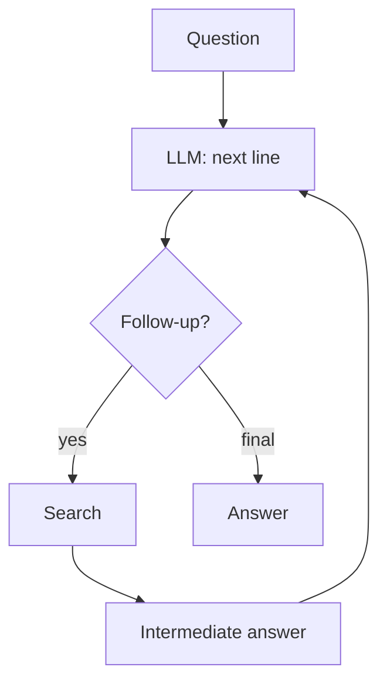
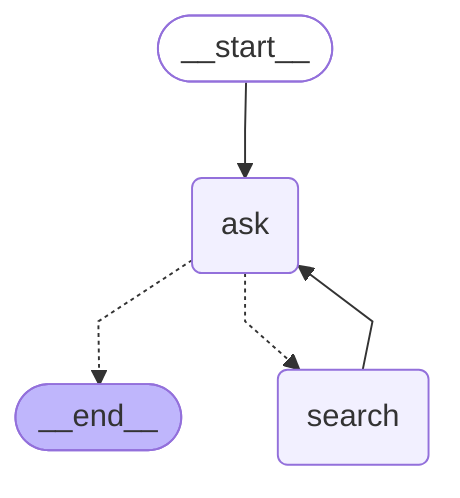

# 12 · Self-Ask

> The model explicitly asks itself simpler follow-up questions, a search engine answers each, and then it composes the final answer — Press et al., 2022

## In plain words

A hard question is often two easy questions glued together. "Who was US president when the Eiffel Tower was finished?" becomes "When was it finished?" (1889) and "Who was president in 1889?". The model writes each small question, a search tool answers it, and then the model puts the answers together.
Like a quiz player thinking out loud: "first I need to know X... got it... now Y... so the answer is Z."

## How it works



1. The LLM writes **one line**: either `Follow up: <simpler question>` or `So the final answer is: <answer>`.
2. A follow-up goes to **search**; its result is added as `Intermediate answer: ...`.
3. The LLM sees the growing scratchpad and writes the next line.
4. Stops at the final answer, or after `MAX_HOPS = 4` follow-ups.

## The LangGraph graph

<!-- mermaid:start -->

<!-- mermaid:end -->

| Node | Role |
|---|---|
| `ask` | LLM writes the next line; `read_line` decides follow-up vs answer |
| `search` | answers the pending follow-up; appends the intermediate answer |

Code: [graph.py](graph.py)

## Plain Python vs LangGraph

Same pattern in [simple.py](simple.py) — a `for` loop over hops.

- The plain loop is shorter and reads like the paper's prompt.
- The graph adds a trace of each hop, and the `search` node can be swapped for a full retrieval subgraph later.

## Run it

```bash
uv run python -m agent_patterns.p12_self_ask.graph
uv run python -m agent_patterns.p12_self_ask.simple
USE_OPENROUTER=1 uv run --env-file .env python -m agent_patterns.p12_self_ask.graph
```

LLM calls in the mock example: **3** (two follow-ups, one final answer).

## When to use

- Multi-hop factual questions ("the X of the Y that did Z").
- You want the reasoning visible as a list of sub-questions you can check.

## When not to use

- Single-hop questions — one search or one call is enough.
- Non-factual tasks (writing, planning) where there's nothing to look up.

## vs. closest pattern

**vs ReAct:** Self-Ask is ReAct narrowed to one tool (search) and an explicit sub-question format. The paper calls the problem it targets the *compositionality gap*: a model can know both facts and still fail to combine them.
