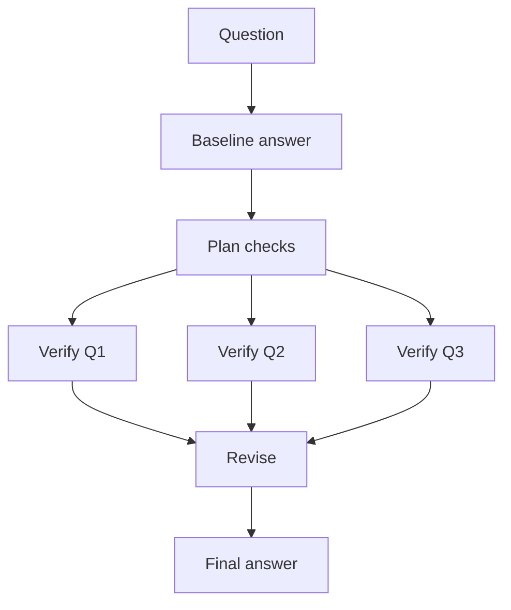
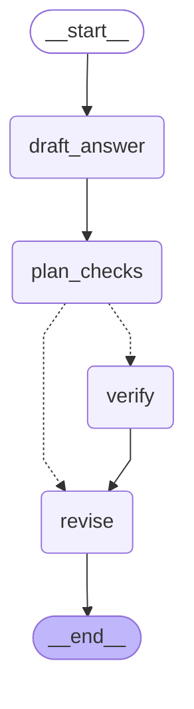

# 13 · Chain-of-Verification

> Draft an answer, plan questions that check each claim, answer those questions independently, then revise the draft — Dhuliawala et al., 2023 ([arXiv 2309.11495](https://arxiv.org/abs/2309.11495))

## In plain words

Models often state wrong facts confidently inside an otherwise good answer. CoVe makes the model fact-check itself claim by claim: write the answer, turn each claim into a simple yes/no question, answer those questions **without looking at the original answer**, and fix whatever failed.
Like a journalist's fact-checker who verifies each claim from scratch instead of rereading the article and nodding along.

## How it works



The verifiers never see the baseline answer — that's what keeps its mistakes from biasing the checks.

1. **Draft** a baseline answer ("Go, Dart and Python").
2. **Plan** one yes/no question per claim (capped at `MAX_CHECKS = 5`).
3. **Verify** each question in its own call, in parallel, without the draft ("Was Python created at Google?" → "No").
4. **Revise** the draft using the verified facts, dropping anything they contradict.

## The LangGraph graph

<!-- mermaid:start -->

<!-- mermaid:end -->

| Node | Role |
|---|---|
| `draft_answer` | LLM baseline answer |
| `plan_checks` | LLM writes check questions; `parse_checks` keeps lines ending in `?` |
| `verify` | one `Send` per check; the payload is only the question (factored) |
| `revise` | LLM revises the draft from the verified Q&A |

Code: [graph.py](graph.py)

## Plain Python vs LangGraph

Same pattern in [simple.py](simple.py) — four steps with a `ThreadPoolExecutor` for the checks.

- The `Send` payload makes the factored isolation explicit: each verifier receives *only* its question, so it structurally can't see the draft.
- Parallel verify calls are traced one by one; with a checkpointer, finished checks survive a failure.

## Run it

```bash
uv run python -m agent_patterns.p13_chain_of_verification.graph
uv run python -m agent_patterns.p13_chain_of_verification.simple
USE_OPENROUTER=1 uv run --env-file .env python -m agent_patterns.p13_chain_of_verification.graph
```

LLM calls in the mock example: **6** (draft, plan, 3 checks, revise).

## When to use

- Answers that list facts (names, dates, attributions) where hallucinations hurt.
- Long answers where a few wrong claims hide among many right ones.

## When not to use

- Creative or opinion tasks — there's nothing to verify.
- Latency-sensitive chat: it's at least 3 extra calls plus one per claim.

## vs. closest pattern

**vs Self-Refine:** CoVe checks factual claims one by one with independent questions; Self-Refine judges overall quality and reads its own draft while doing it.

## Sources

- [Chain-of-Verification Reduces Hallucination in Large Language Models (arXiv 2309.11495)](https://arxiv.org/abs/2309.11495)
