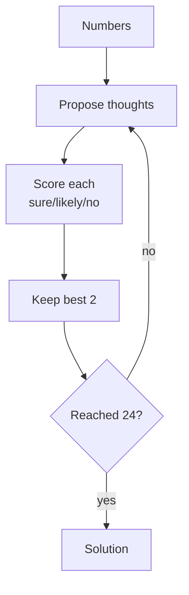
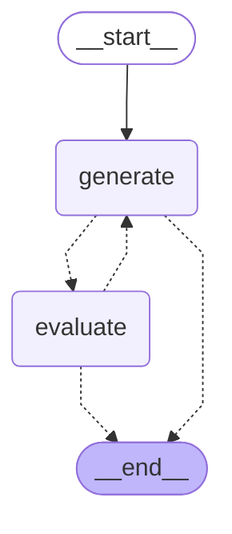

# 14 · Tree of Thoughts

> Explore several reasoning paths at once: propose candidate next steps, score each partial state, prune the weak ones and search deeper — Yao et al., 2023 ([arXiv 2305.10601](https://arxiv.org/abs/2305.10601))

## In plain words

Normal reasoning commits to one line of thought; one bad early step ruins the answer. Tree of Thoughts keeps several partial attempts alive, asks the model how promising each one looks, throws away the hopeless ones, and keeps going with the best few.
Like a chess player: consider a few candidate moves, judge each position, and only think deeper about the promising ones.

## How it works



The example is the paper's **Game of 24**: combine 4 numbers with + − × ÷ to make 24.

1. **Generate**: for each kept state, the LLM proposes up to 3 next steps (`10 - 4 = 6`). Code re-checks the arithmetic and that the numbers exist — the model's math is never trusted.
2. **Evaluate**: the LLM rates each new state `sure` / `likely` / `impossible` (1 / 0.5 / 0).
3. **Prune**: drop `impossible`, keep the best `BEAM = 2` states.
4. Repeat up to `MAX_DEPTH = 3`, stopping as soon as a step reaches 24.

## The LangGraph graph

<!-- mermaid:start -->

<!-- mermaid:end -->

| Node | Role |
|---|---|
| `generate` | `expand`: one propose call per frontier state; validates steps with `apply_step`; detects 24 |
| `evaluate` | `score_and_prune`: one rate call per candidate; keeps the beam |

Code: [graph.py](graph.py)

## Plain Python vs LangGraph

Same pattern in [simple.py](simple.py) — a `for depth in range(...)` loop.

- The plain BFS loop is shorter and reads like the algorithm.
- The graph helps when the search is long and expensive: a checkpointer saves each level, so you can resume, inspect or branch from any level, and the trace shows the search level by level.

## Run it

```bash
uv run python -m agent_patterns.p14_tree_of_thoughts.graph
uv run python -m agent_patterns.p14_tree_of_thoughts.simple
USE_OPENROUTER=1 uv run --env-file .env python -m agent_patterns.p14_tree_of_thoughts.graph
```

LLM calls in the mock example: **10** (4 proposes + 6 ratings) — search is expensive. In the paper's abstract, GPT-4 solved 4% of Game of 24 with chain-of-thought and 74% with ToT.

## When to use

- Puzzles, planning or math where early mistakes are fatal and partial progress can be scored.
- Accuracy matters more than cost or latency (batch or offline jobs).

## When not to use

- Simple Q&A or chat — it can cost 10–100× more LLM calls.
- No reliable way to score intermediate steps — bad scores prune the good branches.

## vs. closest pattern

**vs Chain-of-Thought / Reflexion:** CoT follows one path; Reflexion retries the whole attempt after failing. ToT keeps many partial paths alive and prunes them *while* reasoning — search, not retry. LATS (next in the curriculum) adds Monte-Carlo tree search, tools and reflection on top.

## Sources

- [Tree of Thoughts: Deliberate Problem Solving with Large Language Models (arXiv 2305.10601)](https://arxiv.org/abs/2305.10601)
