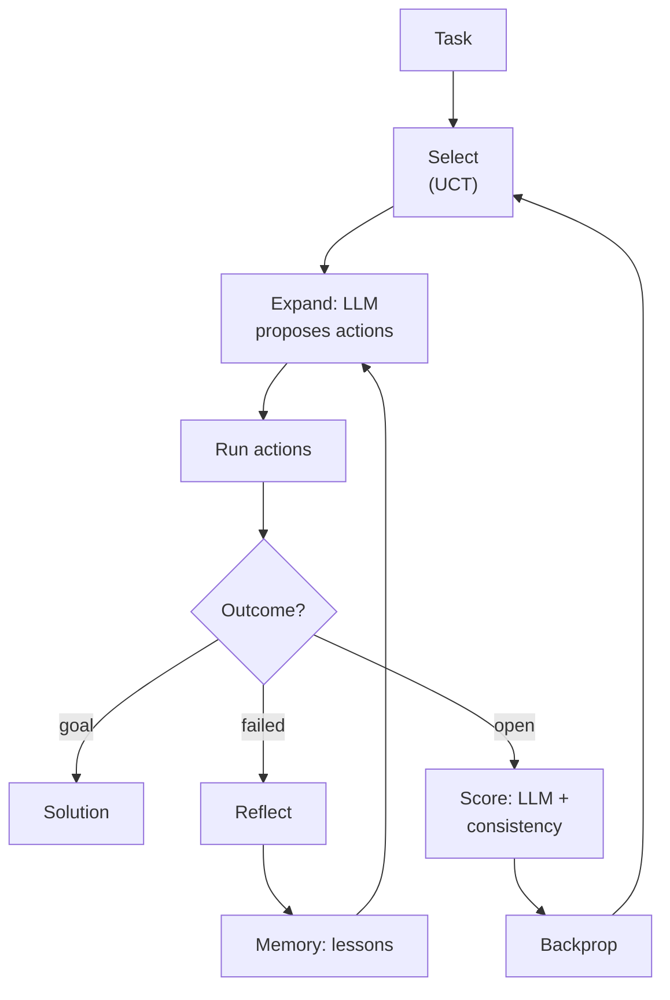
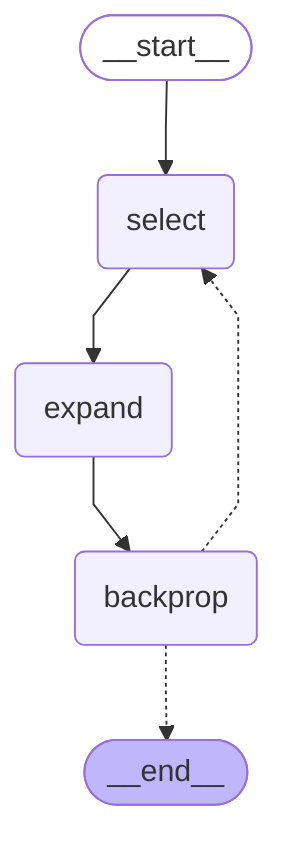

# 15 · LATS

> Language Agent Tree Search: run a Monte-Carlo tree search over real actions, score branches with the LLM, and turn every failed path into a written lesson

## In plain words

ReAct walks a single path and is stuck with its early mistakes. LATS keeps a tree of attempts: it tries actions for real, scores how promising each new state looks, follows the best branch, and when a path fails it writes itself a short lesson and backs up to try a sibling branch instead of starting over.
Like exploring a maze with a notebook: try a corridor, and when it's a dead end, note why, walk back to the last junction and take the most promising other turn.

## How it works



The example: reach 10 from 1 using `+1`, `+3` or `*2` in at most 3 steps.

1. **Select**: walk down the tree by the best `UCT = value + w·√(ln N_parent / N)`, which balances "worked well so far" against "barely tried yet".
2. **Expand**: the LLM proposes 3 next actions (with every lesson so far in its prompt); each one is run for real.
3. **Evaluate**: each new state gets `value = λ·LLM score + (1−λ)·self-consistency` — an action the LLM proposed several times gets a bonus.
4. **Reflect**: a path that fails (overshoots 10 or runs out of steps) gets a one-sentence lesson, stored in memory.
5. **Backprop**: the result flows up the path, so good branches get stronger and failed ones weaker.
6. Repeat until the goal is reached, every branch is a dead end, or `MAX_ITERATIONS = 10`.

In the mock run, `1 → 4 → 7 → 14` overshoots, the lesson "Doubling 7 overshoots 10; from 4 try +1 first, then double 5" is written, and the search backs up to `1 → 4 → 5 → 10`.

## The LangGraph graph

<!-- mermaid:start -->

<!-- mermaid:end -->

| Node | Role |
|---|---|
| `select` | builds the root on the first round, then picks the next leaf by UCT |
| `expand` | `expand`: LLM proposes actions, runs them, scores children, reflects on failed paths |
| `backprop` | updates visits and running-mean values from the leaf up to the root |

Code: [graph.py](graph.py)

## Plain Python vs LangGraph

Same pattern in [simple.py](simple.py) — a `while` loop over the same `select` / `expand` / `backprop` helpers.

- The plain loop is shorter; the search logic lives in the shared helpers either way.
- The graph gives a per-round trace of the search (which leaf was picked, its value and visits), handy when tuning `EXPLORATION` and `LAMBDA`.
- For long, expensive searches you'd add a checkpointer to resume — that needs the tree stored as plain data instead of the in-memory `Node` objects used here (see the `ponytail:` note in `graph.py`).

## Run it

```bash
uv run python -m agent_patterns.p15_lats.graph
uv run python -m agent_patterns.p15_lats.simple
USE_OPENROUTER=1 uv run --env-file .env python -m agent_patterns.p15_lats.graph
```

LLM calls in the mock example: **9** (4 proposals, 4 scores, 1 reflection).

## When to use

- Agent tasks with real feedback where trying several paths is safe: code with tests, SQL against a database, web tasks in a sandbox.
- Accuracy matters more than cost or latency (batch or offline jobs).

## When not to use

- Real-time chat — many LLM calls per answer.
- Irreversible actions (payments, sending email) without a sandbox: the search must be able to try and back up.

## vs. closest pattern

**vs Tree of Thoughts:** ToT searches over *thoughts* with BFS/beam and LLM scores only; LATS searches over *real actions* with environment feedback, UCT selection and written lessons. **vs Reflexion:** Reflexion retries the whole task after a failure; LATS backs up to a sibling branch and keeps the rest of the tree.
