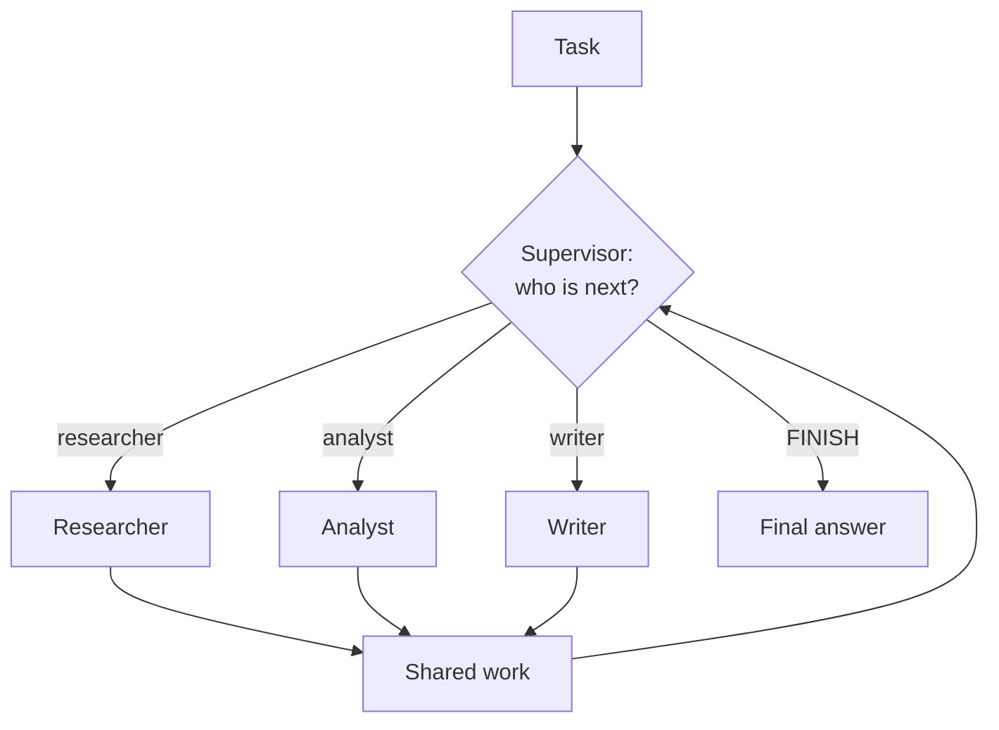
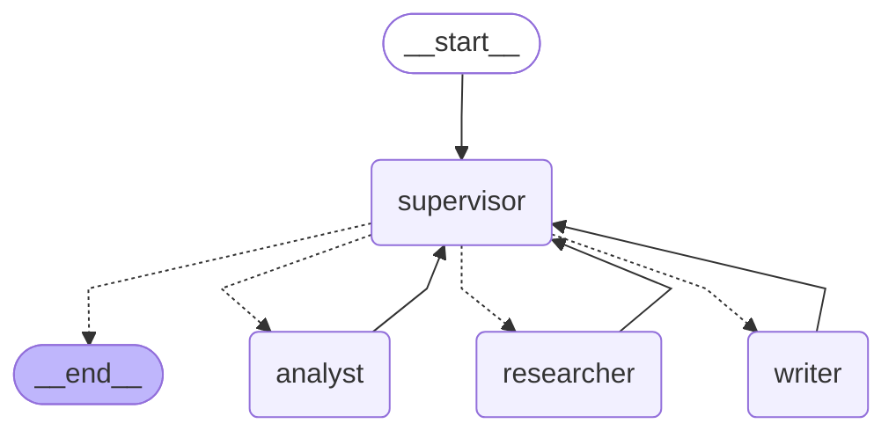

# 16 · Supervisor

> One "boss" LLM reads the shared work and keeps picking which specialist agent acts next, until it decides the task is done

## In plain words

Instead of one agent with a huge prompt and twenty tools, you build a small team: a researcher, an analyst, a writer, each with its own short prompt. A supervisor looks at what the team has done so far and says who goes next. Each worker adds its result to a shared notebook and hands control back, and the supervisor says FINISH when the answer is ready.
Like a project manager at a stand-up: hears the latest update, then decides who works next.

## How it works



1. The task starts an empty shared history.
2. The **supervisor** reads the task and the work so far and replies with one word: a worker's name or `FINISH`.
3. That **worker** runs with its own prompt, adds its output to the history, and hands control back.
4. Repeat until `FINISH` — or `MAX_TURNS = 6` worker runs, after which the supervisor stops without asking the LLM.
5. The last worker's output is the answer. An unrecognized reply from the supervisor also means `FINISH`, so a confused boss stops instead of looping.

## The LangGraph graph

<!-- mermaid:start -->

<!-- mermaid:end -->

| Node | Role |
|---|---|
| `supervisor` | LLM picks the next worker or `FINISH` (`decide` + `parse_next`); stops at `MAX_TURNS` |
| `researcher` / `analyst` / `writer` | each runs with its own prompt, appends to `history`, returns to the supervisor |

Code: [graph.py](graph.py)

## Plain Python vs LangGraph

Same pattern in [simple.py](simple.py) — a `while` loop with a dict of workers.

- The plain loop is shorter for three simple workers.
- In the graph each worker is its own node, so any one of them can grow into a full sub-agent (say, a ReAct agent with its own tools) without touching the others, and the trace shows exactly who acted when.
- LangChain's prebuilt `langgraph-supervisor` package is no longer its recommended route; it now points to "subagents as tools", where the supervisor calls each worker like a tool. This repo builds the loop by hand so the mechanics stay visible.

## Run it

```bash
uv run python -m agent_patterns.p16_supervisor.graph
uv run python -m agent_patterns.p16_supervisor.simple
USE_OPENROUTER=1 uv run --env-file .env python -m agent_patterns.p16_supervisor.graph
```

LLM calls in the mock example: **7** (4 supervisor decisions + 3 worker turns) — every worker step costs one extra supervisor call.

## When to use

- Several specialists with their own prompts or tools, where the next step depends on the last result.
- One agent with many tools keeps picking the wrong one — split the tools across workers.

## When not to use

- The steps are fixed and known — a prompt chain does it without the supervisor calls.
- One agent with a few tools already handles the task.

## vs. closest pattern

**vs Orchestrator-workers:** the orchestrator plans every subtask up front and runs them in parallel; the supervisor decides one step at a time and can call the same worker again. **vs Routing:** a router picks once; a supervisor keeps picking in a loop.
