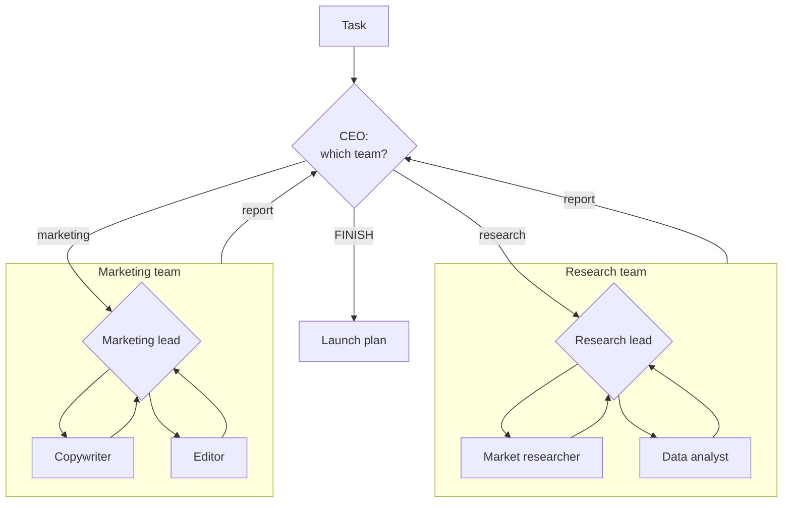
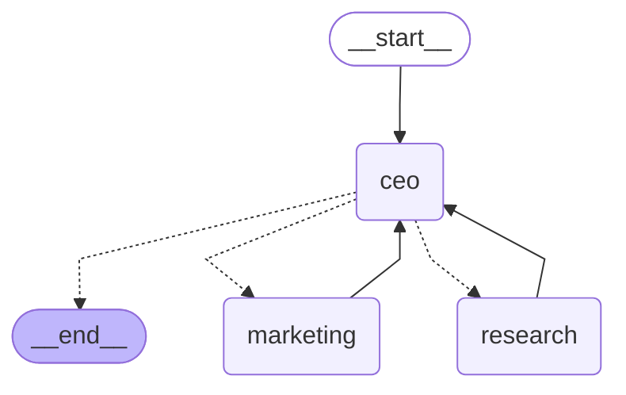

# 17 · Hierarchical teams

> A top supervisor manages teams instead of individual agents; each team has its own lead who manages the team's members

## In plain words

One boss can't keep track of fifteen specialists. So you organize agents the way a company does: the CEO talks only to team leads, and each lead runs a small team. The CEO decides which team works next; the lead decides which member works next, and reports back when the team's part is done.
Like a real company: the CEO doesn't tell the copywriter what to write — she asks marketing for a launch line, and the head of marketing handles the rest.

## How it works



1. The **CEO** reads the task and every team's report so far, and names the next team — or `FINISH`.
2. That team's **lead** picks members one at a time — or `DONE`. Each member has its own prompt and sees the other teams' reports.
3. When the lead says `DONE`, the team's work goes back to the CEO as one **report**.
4. Both levels are capped (`MAX_TEAM_TURNS = 4`, `MAX_WORKER_TURNS = 4`), and an unrecognized reply ends that level instead of looping.

**The example — a startup launching HydroSmart, a smart water bottle:**

| Who | What they did |
|---|---|
| CEO | sends the task to **research** |
| Market researcher | "Buyers: gym-goers aged 25-40. Competitor bottles sell for $35-$45." |
| Data analyst | "Launch at $39: inside the $35-$45 range, about 30% margin on a $27 unit cost." |
| CEO | reads research's report, sends the task to **marketing** |
| Copywriter | "HydroSmart reminds gym-goers to drink, for $39." — built on research's findings |
| Editor | "HydroSmart: the smart bottle that keeps you hydrated. Launch price $39." |
| CEO | `FINISH` — the editor's line is the answer |

## The LangGraph graph

<!-- mermaid:start -->

<!-- mermaid:end -->

| Node | Role |
|---|---|
| `ceo` | top supervisor: picks the next team or `FINISH` |
| `research` / `marketing` | each calls its **own compiled team graph** (`build_team_graph`) and adds the team's report |

Inside each team graph: a `lead` node and one node per member — the Supervisor pattern (16), one level down. The team graph has its own state (`TeamState`), so the parent calls it from a node and maps the result back.

Code: [graph.py](graph.py)

## Plain Python vs LangGraph

Same pattern in [simple.py](simple.py) — two nested `while` loops, the same shape as the org chart.

- Plain Python reads fine for two small teams.
- In the graph every team is a separate, compiled graph: you can build, test and trace one team on its own, then plug it into the company — or reuse the same research team under a different CEO.
- Each team keeps a private state: members only see the other teams' final reports, not their internal chatter, so prompts stay short.

## Run it

```bash
uv run python -m agent_patterns.p17_hierarchical_teams.graph
uv run python -m agent_patterns.p17_hierarchical_teams.simple
USE_OPENROUTER=1 uv run --env-file .env python -m agent_patterns.p17_hierarchical_teams.graph
```

LLM calls in the mock example: **13** (CEO 3, each lead 3, four members 1 each) — every layer adds its own routing calls.

## When to use

- Too many agents for one supervisor: group them into teams with clear areas (research, engineering, marketing, support tiers).
- Teams that can be built, tested and reused on their own.

## When not to use

- A handful of agents — one Supervisor is simpler and cheaper.
- Low latency: each extra level adds routing calls before any real work happens.

## vs. closest pattern

**vs Supervisor:** a single boss picks individual agents; here the boss picks teams, and each team runs its own Supervisor loop inside.
