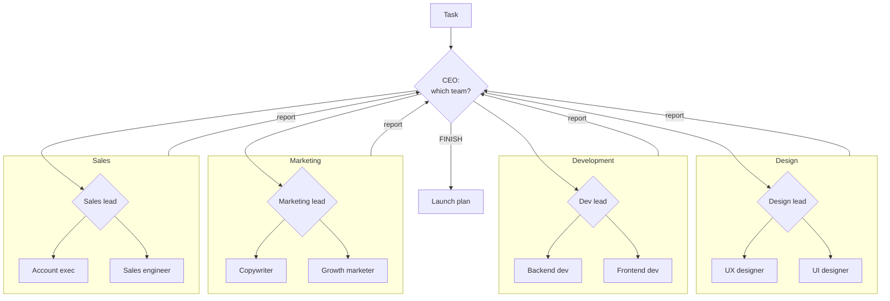
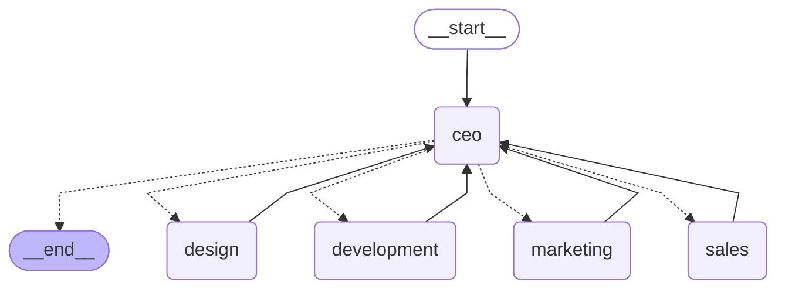

# 17 · Hierarchical teams

> A top supervisor manages teams instead of individual agents; each team has its own lead who manages the team's members

## In plain words

One boss can't keep track of fifteen specialists. So you organize agents the way a software company does: the CEO talks only to team leads, and each lead runs a small team. The CEO decides which team works next; the lead decides which member works next, and reports back when the team's part is done.
Like a real startup: the CEO doesn't tell the frontend developer which button to build — she asks the development team for the feature, and the dev lead handles the rest.

## How it works



1. The **CEO** reads the task and every team's report so far, and names the next team — or `FINISH`.
2. That team's **lead** picks members one at a time — or `DONE`. Each member works with its own prompt, reports back to its lead, and sees the other teams' reports.
3. When the lead says `DONE`, the team's work goes back to the CEO as one **report**.
4. When the CEO says `FINISH`, all the reports together are the answer.
5. Both levels are capped (`MAX_TEAM_TURNS = 8`, `MAX_WORKER_TURNS = 4`), and an unrecognized reply ends that level instead of looping.

**The example — a software startup launching "Smart Reminders" in its task app, TaskFlow:**

| Team | Member | What they did |
|---|---|---|
| Design | UX designer | the user types a task, the app suggests a reminder time from their calendar, one tap accepts it |
| Design | UI designer | a reminder chip under each task with a bell icon; swipe to snooze |
| Development | Backend dev | reminder API and a job queue that reads the calendar; about two sprints |
| Development | Frontend dev | builds the chip and swipe to snooze from the design; ships behind a feature flag |
| Marketing | Copywriter | "Smart Reminders: TaskFlow now tells you when, not just what." |
| Marketing | Growth marketer | launch email to 20k users plus an in-app banner; goal: 15% try it in month one |
| Sales | Account exec | pitch to the 40 team accounts; offer it in the Pro plan |

Each team builds on the ones before it: development works from design's flow, marketing and sales sell what development ships. The sales lead decided one member was enough and never called the sales engineer.

## The LangGraph graph

<!-- mermaid:start -->

<!-- mermaid:end -->

| Node | Role |
|---|---|
| `ceo` | top supervisor: picks the next team or `FINISH` |
| `design` / `development` / `marketing` / `sales` | each calls its **own compiled team graph** (`build_team_graph`) and adds the team's report |

Inside each team graph: a `lead` node and one node per member — the Supervisor pattern (16), one level down. The team graph has its own state (`TeamState`), so the parent calls it from a node and maps the result back.

Code: [graph.py](graph.py)

## Plain Python vs LangGraph

Same pattern in [simple.py](simple.py) — two nested `while` loops, the same shape as the org chart.

- Plain Python reads fine at this size.
- In the graph every team is a separate, compiled graph: you can build, test and trace one team on its own, then plug it into the company — or reuse the same design team under a different CEO.
- Each team keeps a private state: members see the other teams' final reports, not their internal chatter, so prompts stay short.

## Run it

```bash
uv run python -m agent_patterns.p17_hierarchical_teams.graph
uv run python -m agent_patterns.p17_hierarchical_teams.simple
USE_OPENROUTER=1 uv run --env-file .env python -m agent_patterns.p17_hierarchical_teams.graph
```

LLM calls in the mock example: **23** (CEO 5, leads 11, members 7) — every layer of management adds its own routing calls.

## When to use

- Too many agents for one supervisor: group them into teams with clear areas (design, development, marketing, sales).
- Teams that should be built, tested and reused on their own.

## When not to use

- A handful of agents — one Supervisor is simpler and cheaper.
- Low latency: each level of management adds routing calls before any real work happens.

## vs. closest pattern

**vs Supervisor:** a single boss picks individual agents; here the boss picks teams, and each team runs its own Supervisor loop inside.
